<div align="center">



# 🦀✨ AGY Claude Style (`agy-claude-style`)

**让会眨眼、会摸鱼、还能被挠痒痒的像素小螃蟹 `Clawd` 陪你在 Google Antigravity 里写代码** `(๑•̀ㅂ•́)و✧`

为 **Google Antigravity**（Windows / macOS / Linux）打造的一体化界面重塑、思考滑块、首页用量看板与 5 语言本地化原生插件。<br/>
基于 **零工具 MCP 生命周期托管 + Chrome DevTools Protocol（CDP）动态注入**——不改动任何原版安装文件，支持热更新与一键无痕还原 🌊

`Antigravity 原生插件` · `Windows / macOS / Linux` · `19 套 Clawd 动画` · `3 风格思考滑块` · `5 语言切换` · `0 Token MCP 托管` · `MIT`

</div>

> [!NOTE]
> **来源与魔改说明**：本项目灵感及部分源码来源于 [Nwflower/dsh-claude-style](https://github.com/Nwflower/dsh-claude-style)、Codex 思考滑块样式来源于 [Microqian2th/dsh-codex-effort-slider](https://github.com/Microqian2th/dsh-codex-effort-slider)、梁武峰思考滑块样式来源于 [mobius/dsh-performance-slider](https://github.com/mobius/dsh-performance-slider)。<br/>
> **本地魔改版定位**：现已重构为 **Antigravity 原生插件一体化托管架构**，新增右侧辅助栏 **Claude Style** 控制面板、Antigravity 2.33.0+ CDP 调试端口自动补全与一键带参重启，并精简移除了对话内叠层用量浮窗与配额遥测功能，保持轻量专注，可与 `usage-monitor` 等独立用量监控插件零冲突共存。

---

## ✨ 核心能力

### 🧩 1. 原生插件一体化托管 & Studio 控制面板
- **零上下文开销 MCP 托管**（[mcp_config.json](mcp_config.json) → [plugin/mcp-host.js](plugin/mcp-host.js)）：`tools/list` 返回空列表，消耗 `0` 个对话上下文 Token；在 Antigravity **Customizations** 中拨动插件开关即可自动实时注入或无痕退出还原。
- **反孤儿与管道防呆看门狗**（[lifecycle.js](lifecycle.js)）：持续监测 Language Server `/healthz` 与 stdio 断连状态，宿主退出或插件停用时立即清理自身与子进程，不留残留锁文件或后台进程。
- **右侧辅助栏 Studio 控制面板**（[sidecars/studio/](sidecars/studio/index.html)）：名为 **Claude Style**，支持 5 语言界面与自动跟随宿主深浅色主题，集中提供 **2 组共 14 项**可视化配置及「立即注入 / 刷新」「无痕恢复原版」「恢复默认配置」「刷新状态」快捷操作。
- **Antigravity 2.33.0+ 调试端口自动适配**：自动为 Antigravity IDE（`~/.antigravity-ide/argv.json`）及 Desktop 启动入口（Windows `.lnk` 快捷方式 / Run 注册表、Linux `.desktop`）补齐 `--remote-debugging-port=0`（尊重 macOS `.app` 签名不改写包内文件）；若未检测到可用 CDP 端口，可直接在 Studio 面板点击「**一键重启并启用调试端口**」。
- **配置隔离与自动迁移**（[cdp.js](cdp.js)）：原生插件模式下状态文件与 `config.json` 自动隔离存储于 `${PLUGIN_DATA}`（首次启用自动从旧版根目录 `config.json` 单次迁移），采用原子写入并自动过滤已废弃的历史 HUD 配置键。
- **精准目标过滤与生态共存**：自动识别 Desktop 主窗口与 IDE 扩展聊天 `iframe`，跳过 DevTools、外部页面以及 `Usage Monitor`、`Swarm Board`、`AGY Claude Style Studio` 侧栏；同时保护 `#ag-usage-monitor-capsule` 与 `#ag-usage-monitor-portal` 节点不被翻译引擎或清理脚本误伤。

### 🌌 2. Studio 首页、字符波纹海与编程用量看板
- **保留原生识别与三套调色板**：首页顶部保留 Antigravity 原生拱形 Logo（`logoInk`: `accent` / `foreground`），提供 `obsidian`（黑曜石蓝暗色）、`claude`（暖炭灰）与 `host`（跟随宿主）三套配色方案，自动适配深浅色模式；`homeLayout` 支持在 `studio` / `classic` / `off` 间切换。
- **实时字符矩阵波纹场（`homeRipple`）**（[ripple-core.js](ripple-core.js)）：在首页铺设等宽字母数字二维波动网格并叠加云雾漂移效果，轻点首页空白处即可触发柔和的阻尼水波纹扩散动画 `~(˘▾˘~)`。
- **首页编程用量看板**（[usage-core.js](usage-core.js)）：自动聚合本地对话轨迹并剔除子代理重复会话计数，支持 **概览 / 模型** 视图与 **全部 / 30 天 / 7 天** 时间范围切换，展示 6 项核心指标（会话数、消息数、Token 总量、活跃天数、高峰时段、最常用模型）、`26×7` 周日历热力图、30 天模型堆叠柱状图，以及 **60+ 本经典著作 Token 折算标尺** 📖✨。

### 🎚️ 3. 三风格交互式思考强度滑块 (`effortSliderStyle`)
点击模型名旁的思考强度徽章（支持 `Low` / `Medium` / `High` / `XHigh` / `Max` 映射并保留宿主 `Extra` 标识，覆盖 Flash / Hydrogen / Neon / Carbon / Argon / Helix / Orchestrator / Pro / Opus / Sonnet 等模型族），弹出交互式推理档位调节器（[effort-core.js](effort-core.js)）：
- **Claude Code (`claude`)**：5 行动态矩阵噪声点阵、发光竖向胶囊滑块，支持 `effortAccent` 蓝紫渐变色阶开关。
- **ChatGPT Codex (`chatgpt`)**：蓝→紫渐变进度条、高档位星云扫光、星空粒子与阻尼刻度手感 ✨。
- **梁武峰 (`liangwufeng`)**：内置 31 帧 `320×320` WebP 抠像人像序列（[perf-assets.js](perf-assets.js)），支持 `performanceBackdrop`（`card` 仅卡片 / `page` 全窗口 / `off` 关闭）三种展示模式。

### ⌨️ 4. 极简输入框、丝滑光标与温柔侧栏
- **极简输入框重排（`composerRestyle`）**：重排圆角输入卡片与底部无边框控制栏，支持 `placeholderStyle`（`studio` 引导语 / `host` 原生提示）。
- **丝滑打字光标（`smoothCaret`）**：渲染平滑插值位移动画光标（`.ag-cs-smooth-caret`），兼容多行换行与中文输入法（IME）候选态。
- **侧栏样式优化（`sidebarRestyle` / `sidebarCompact`）**：统一侧边栏行高与悬停高亮底板，支持开启更紧凑的条目间距以在一屏显示更多对话。

### 🦀 5. 像素螃蟹小跟班 `Clawd` (`mascot`)
- 在输入框右上角蹲着一只超有戏的像素小螃蟹 `Clawd`（内置 **19 套双层精灵图动画**），跟随对话轨迹中的 `idle`、`thinking`、`typing`、`error`、`sleeping`、`waking` 等状态实时切换，空闲时还会自己抱着小本本摸鱼或对你招手 👋。
- **礼貌避让**：当输入框上方出现排队消息、`/` 命令菜单或问答确认卡片时，Clawd 会自动调整留白或让位，绝不遮挡发送、编辑、删除等按钮。

### 🌐 6. 5 语言全局切换 & 双端可视化设置
- **5 语言全局本地化（`language`）**（[i18n-core.js](i18n-core.js) / [i18n-locales.js](i18n-locales.js)）：支持 **简体中文 (`zh-CN`) / 繁體中文 (`zh-TW`) / 粵語 (`yue`) / English (`en`) / 日本語 (`ja`)** 实时切换；自动跳过代码编辑器、终端、对话正文、`data-ag-no-i18n` 与 `#ag-usage-monitor-*` 保护区，停用或移除时无损还原。
- **双端同步设置**：既可在右侧辅助栏 **Claude Style** 面板调节，也可直接在 Antigravity **设置 → 外观** 底部同步调整这 **2 组共 14 项**可视化开关，所有更改即时热更新并持久化保存。

---

## 🦀 小螃蟹 Clawd 饲养指南

Clawd 是由 [crab-assets.js](crab-assets.js) 与 [mascot-core.js](mascot-core.js) 驱动的双层像素小生命，住在你的输入框右上角 🏡：

<div align="center">
  
</div>

### 🎮 互动彩蛋一览

| 互动方式 | 触发方法 | Clawd 的反应 |
| --- | --- | --- |
| 👉 **轻戳小钳子** | 单击 Clawd 的左半边或右半边身体 | 害羞扭头给你看不同方向的小动作 (`poke-left` / `poke-right`) |
| 🤭 **疯狂挠痒痒** | `450ms` 内快速连点 Clawd **4 下** | 触发爆笑踢腿大反应 (`tickle`)，眼睛笑成 `^ ^`！ |
| 🤏 **拎起来晃一晃** | 按住鼠标左键拖拽 Clawd | 进入悬空手舞足蹈模式 (`drag`)，松手才乖乖落地 |
| 💤 **挂机小憩** | 对话安静超过 **60 秒** | 自动缩成一团进入 `sleeping` 呼呼模式，点一下或发消息立刻伸懒腰 `waking` |
| 🎉 **任务报喜** | AI 回复完成或出现错误时 | 成功了开心蹦跶 (`happy`)，出错了也会陪你慌张一下 (`error`) |

<details>
<summary>🎀 <b>点此展开：查看 Clawd 全部 19 套双层精灵图动画</b></summary>

- **日常发呆 & 随机彩蛋**：`idle`（待机呼吸）、`idle-look`（左顾右盼）、`idle-wave`（举钳打招呼）、`idle-laptop`（抱着迷你笔记本敲代码）
- **认真营业中**：`thinking`（托腮冒气泡思考）、`typing`（哒哒哒飞速打字）、`building`（敲敲打打搞建设）、`compacting`（打包整理上下文）、`music`（戴上小耳机听歌）、`conducting`（挥舞指挥棒）
- **心情与睡眠**：`happy`（撒花蹦跶）、`notification`（来新消息啦）、`error`（哎呀报错了）、`sleeping`（冒着 `Zzz` 睡觉）、`waking`（睡醒伸懒腰）
- **玩家互动专属**：`poke-left`（被戳左边）、`poke-right`（被戳右边）、`tickle`（怕痒爆笑）、`drag`（被拎起来晃）

</details>

---

## 🚀 快速上手

### 🧩 方式一：Antigravity 原生插件模式（推荐，支持 2.0 / IDE）

1. 将仓库放入 Antigravity 全局插件目录：
   ```powershell
   # Windows PowerShell
   git clone https://github.com/0DNANCY/agy-claude-style.git "$env:USERPROFILE\.gemini\config\plugins\agy-claude-style"
   ```
   ```bash
   # macOS / Linux / agy CLI
   git clone https://github.com/0DNANCY/agy-claude-style.git ~/.gemini/config/plugins/agy-claude-style
   # 或使用 CLI: agy plugin install https://github.com/0DNANCY/agy-claude-style
   ```
2. 在 Antigravity **Customizations → Installed** 中启用 `agy-claude-style`：
   - 零工具 MCP 宿主（`agy-claude-style-host`）会随插件启用自动启动 CDP 守护；停用插件开关时自动无痕还原原生界面。
   - 打开右侧辅助栏 **Claude Style** 面板即可可视化调节全部 14 项设置；如果使用的 Antigravity 2.33.0+ 默认未开启调试端口，面板顶部会提示并展示「**一键重启并启用调试端口**」按钮，点击一次即可带 `--remote-debugging-port=0` 重启生效。
   - 如需彻底清理自动写入桌面启动器的调试参数，可运行 `node remove.js --clean-launchers`。

### 💻 方式二：Node.js 脚本模式（Windows / macOS / Linux）

1. 克隆仓库并按需复制默认配置（若不创建将自动使用内置默认值）：
   ```bash
   git clone https://github.com/0DNANCY/agy-claude-style.git
   cd agy-claude-style
   cp config.example.json config.json
   ```
2. 启动注入 / 热更新守护 / 卸载还原：
   - **npm 命令**（全平台通用）：
     ```bash
     npm run watch    # 后台持续守护并监听 *.js / *.css / config.json 热更新
     npm run inject   # 单次立即注入当前所有 Antigravity 窗口
     npm run remove   # 停止守护并无损恢复原生界面
     ```
   - **Windows 快捷脚本**：`watch.bat`（配合 `watch-hidden.vbs` 无黑框运行，日志写入 `watch.log`）、`inject.bat`、`remove.bat`、`autostart-on.bat` / `autostart-off.bat`。
   - **macOS / Linux Shell 脚本**：`chmod +x *.sh` 后运行 `./watch.sh`、`./inject.sh`、`./remove.sh`。
   - 如需一并清理写入启动器的 `--remote-debugging-port=0` 参数，可执行 `node remove.js --clean-launchers`。

### 📦 方式三：独立安装包（目标机器无需 Node.js）

不想在目标电脑安装 Node.js 时，可从 [Releases](https://github.com/0DNANCY/agy-claude-style/releases) 下载对应平台独立包，或在本机从源码编译：

- **Windows (`installer.exe`)**：运行 `npm run build:installer` 编译；双击 `installer.exe` 自动部署至 `%LOCALAPPDATA%\agy-claude-style`（升级保留已有 `config.json`）、注册开机自启与「设置 → 应用」卸载项，并启动静默守护 `agy-claude-style-watcher.exe`。
  ```text
  installer.exe [--silent | /S | -s] [--uninstall] [--status]
                [--no-autostart] [--no-kill-legacy]
                [--install-dir <路径>] [--cdp-port <端口>]
                [--out <结果JSON路径>] [--popup]
  ```
- **macOS (`AGY-Claude-Style-macOS-universal.dmg`)**：在 macOS 运行 `npm run build:macos` 编译生成通用架构（`arm64` + `x86_64`）`.app` 与 `.dmg`；将 `AGY Claude Style.app` 拖入「应用程序」后首次请右键「打开」（或执行 `xattr -cr "/Applications/AGY Claude Style.app"`），自动部署至 `~/Library/Application Support/agy-claude-style` 并配置 `LaunchAgent` 登录守护；再次打开 `.app` 点击「卸载并恢复原版」即可完全还原。

---

## ⚙️ 配置说明 (`config.json`)

- **配置文件优先级**：环境变量 `AGY_CLAUDE_STYLE_CONFIG` > 原生插件 `${PLUGIN_DATA}/config.json`（首次自动从旧版仓库根目录 `config.json` 单次迁移）> 仓库根目录 `config.json`（默认模板见 [config.example.json](config.example.json)）。
- **实时热更新与自动清洗**：通过 **Claude Style** 面板、Antigravity `设置 → 外观` 或直接编辑 `config.json` 修改后即时生效；读取和保存时会自动清洗已废弃的历史 HUD 字段。

### 外观与版面（共 8 项）

| 配置键 | 可选值 / 类型 | 默认值 | 说明 |
| --- | --- | --- | --- |
| `language` | `'zh-CN'` \| `'zh-TW'` \| `'yue'` \| `'en'` \| `'ja'` | `'zh-CN'` | 🌐 5 语言全局界面与插件面板本地化（简中/繁中/粤语/英文/日语） |
| `homeLayout` | `'studio'` \| `'classic'` \| `'off'` | `'studio'` | 🏠 新会话首页布局（Studio 用量看板 / 居中经典 / 恢复原生） |
| `palette` | `'obsidian'` \| `'claude'` \| `'host'` | `'obsidian'` | 🎨 配色方案（Obsidian 深邃蓝黑 / Claude 暖灰 / 跟随宿主） |
| `logoInk` | `'accent'` \| `'foreground'` | `'accent'` | ✒️ 首页顶部 Antigravity 拱形 Logo 着色风格 |
| `sidebarRestyle` | `boolean` | `true` | 📑 侧边栏 Claude 风格行高与悬停高亮底板 |
| `sidebarCompact` | `boolean` | `false` | 📏 侧边栏紧凑间距模式，一屏显示更多条目 |
| `composerRestyle` | `boolean` | `true` | 💊 极简圆角输入卡片与底部无边框控制栏 |
| `placeholderStyle` | `'studio'` \| `'host'` | `'studio'` | 💬 输入框占位提示风格（Studio 引导语 / 宿主原生文案） |

### 交互、光标与思考滑块（共 6 项）+ 高级轮询配置

| 配置键 | 可选值 / 类型 | 默认值 | 说明 |
| --- | --- | --- | --- |
| `effortSliderStyle` | `'claude'` \| `'chatgpt'` \| `'liangwufeng'` | `'claude'` | 🎚️ 思考强度滑块浮窗风格 |
| `effortAccent` | `boolean` | `true` | 💜 Claude 模式下启用蓝紫思考强度色阶（关闭为黑白灰） |
| `performanceBackdrop` | `'card'` \| `'page'` \| `'off'` | `'card'` | 🖼️ 梁武峰模式下 31 帧人像背景渲染范围 |
| `smoothCaret` | `boolean` | `true` | ✨ 输入框丝滑插值打字光标（兼容多行与中文输入法） |
| `mascot` | `'crab'` \| `'off'` | `'crab'` | 🦀 输入框右上角像素螃蟹挂件 `Clawd` |
| `homeRipple` | `boolean` | `true` | 🌊 首页交互式二维字符矩阵波纹背景 |
| `pollIntervalMs` | `number`（最小 `1500`） | `2500` | ⏱️ 高级配置（仅 `config.json`）：首页看板与对话状态轮询间隔（毫秒） |

---

## 🎒 环境要求

- **Google Antigravity Desktop / IDE**：运行中且开启内置 CDP 调试端口（自动探测用户目录 `Antigravity/DevToolsActivePort`，或通过 `AG_CDP_PORT` / `--cdp-port` 指定）：
  - Windows：`%APPDATA%\Antigravity\DevToolsActivePort`
  - macOS：`~/Library/Application Support/Antigravity/DevToolsActivePort`
  - Linux：`${XDG_CONFIG_HOME:-~/.config}/Antigravity/DevToolsActivePort`
- **Node.js >= 22**：原生插件托管、脚本模式、测试与安装器构建均零第三方 npm 依赖，仅使用 Node.js 内置 `fetch`、`WebSocket` 与 `node:test`。
- **可选本地构建工具**：Windows 源码编译 `installer.exe` 需要 `.NET Framework 4.x (csc.exe)`（Win10/11 自带）；macOS 源码编译 `.app` / `.dmg` 需要 `Xcode Command Line Tools (swiftc)`。

---

## 🗂️ 项目结构

```text
agy-claude-style/
├── .github/workflows/         # GitHub Actions CI 测试 (ci.yml) 与跨平台 Release 自动发布 (release.yml)
├── assets/                    # 插件图标 (logo.svg) 与 README 像素螃蟹插图 (clawd-banner.svg / clawd-moods.svg)
├── plugin.json                # Antigravity 原生插件清单
├── mcp_config.json            # 零工具 MCP 生命周期宿主配置 (tools/list -> [])
├── plugin/mcp-host.js         # 原生插件 MCP 保活入口（随插件开关/宿主启停自动注入与无痕还原）
├── sidecars/studio/           # 右侧辅助栏可视化控制面板 Sidecar（5 语言 UI + 一键重启启用 CDP）
├── lifecycle.js               # 宿主存活看门狗、管道断连防护、CDP 启动器补全与安全重拉核心
├── watcher-core.js            # 多窗口 CDP 热更新守护控制器（监听源码与 ${PLUGIN_DATA}/config.json）
├── cdp.js                     # CDP 客户端、配置迁移清洗、目标窗口/iframe 过滤与注入表达式构建
├── inject.js                  # 单次注入与 --watch 热更新守护入口（含设置绑定持久化）
├── remove.js                  # 停止守护进程、无损恢复原生界面（支持 --clean-launchers）
├── config.example.json        # 默认配置文件模板
├── style.css                  # 全套调色板、Studio 首页看板、极简输入框、光标与思考滑块样式
├── ui-runtime.js              # 前端运行时：Store/Fiber 桥接、首页看板、思考滑块、Clawd 与设置同步
├── i18n-core.js               # 5 语言 DOM 翻译引擎（含保护区跳过与无损还原）
├── i18n-locales.js            # 简中 / 繁中 / 粤语 / 英文 / 日语多语言词典
├── usage-core.js              # 会话轨迹解析、子代理去重、热力图、书籍标尺与 Clawd 活动状态检测
├── effort-core.js             # 多模型族推理档位映射、阻尼刻度数学模型与 3 套滑块核心逻辑
├── mascot-core.js             # 像素螃蟹 Clawd 状态机（休眠、唤醒、互动彩蛋与状态优先级）
├── ripple-core.js             # 首页字符矩阵噪声与二维水波方程求解器
├── crab-assets.js             # 内置 19 套像素螃蟹双层精灵图（body + ink PNG Data URI）
├── perf-assets.js             # 内置 31 帧 320×320 WebP 人像序列
├── installer/                 # Windows (C#) 与 macOS (Swift) 独立安装器及原生守护进程源码
├── scripts/                   # 跨平台图标、安装器与 macOS .dmg 构建脚本
├── test/                      # 基于 node:test 的单元测试、生命周期、原生插件与安装器端到端测试套件
└── *.bat / *.sh / *.vbs       # 各平台快捷启动、守护、还原与开机自启脚本
```

---

## 🧪 开发、测试与构建

```bash
# 运行全部单元测试、原生插件生命周期与对应平台安装器端到端测试（Node.js >= 22）
npm test

# 在 Windows 上编译生成独立 installer.exe
npm run build:installer

# 在 macOS 上编译生成 Universal .app 与 .dmg
npm run build:macos
```

仓库配置了 GitHub Actions 工作流（[ci.yml](.github/workflows/ci.yml) 与 [release.yml](.github/workflows/release.yml)）：推送 `v*` 版本标签或手动触发即可自动在 `windows-latest` 与 `macos-latest` 完成全量测试与安装包构建发布。

---

## 💌 来源声明

本项目在设计与实现过程中参考并使用了以下开源项目的灵感、样式及部分源码，特此声明并致谢 🌸：

- **项目灵感来源及部分源码来源**：[https://github.com/Nwflower/dsh-claude-style](https://github.com/Nwflower/dsh-claude-style)
- **Codex 思考强度滑杆样式**：[https://github.com/Microqian2th/dsh-codex-effort-slider](https://github.com/Microqian2th/dsh-codex-effort-slider)
- **梁武峰思考强度滑杆样式**：[https://github.com/mobius/dsh-performance-slider](https://github.com/mobius/dsh-performance-slider)

---

## 📜 开源协议

本项目基于 [MIT License](LICENSE) 开源。

<div align="center">

```text
      ╭───────────────────────────────────╮
      │  "What's up next? Let's ship it!" │
      ╰─────────────────┬─────────────────╯
                 ████████████████
                 ██▀▀████████▀▀██
             ████████████████████████
                 ████████████████
                 ██ ██      ██ ██
```

<sub>愿每一行代码都有小螃蟹默默陪你加油 `(っ˘ω˘ς ) ☕️` · 喜欢的话欢迎点亮右上角 ⭐ Star！</sub>

</div>
